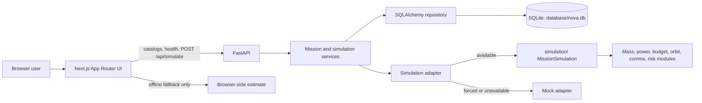

# Architecture

## System overview

NOVA MISSION COMMAND is a local web application with a browser-based planner, a FastAPI backend, a SQLite persistence layer, and a Python simulation package. The browser and the backend are separate processes during development.

## Frontend

The Next.js 14 App Router application is under `frontend/src`. `src/app/page.tsx` switches between the dashboard, Mission Builder, simulation panel, and two “Coming soon” panels. The interface is currently French.

The Mission Builder consists of five steps: mission, spacecraft, launcher, payload, and review. Local catalogs contain destinations and spacecraft buses; the launcher and instrument catalogs are fetched from the API when available, with local fallback values. Constraint gauges and pre-flight validation run in the browser. The current draft is saved in browser `localStorage`, not on the server.

The Builder submits a direct simulation request to `POST /api/simulate`. If the service is unreachable, it displays a client-side feasibility estimate and identifies it as local. An HTTP error from a reachable backend is shown as a backend refusal instead of being converted into a successful-looking estimate.

The separate Mission API can persist mission records, but the current Builder does not call its create/update endpoints. The dashboard's activity list, mission/team counts, and decorative telemetry are presentation data rather than database-backed telemetry.

## Backend

`backend/main.py` is the Uvicorn entry point and imports the FastAPI application factory in `backend/app/main.py`. The application registers:

- Health, service status, and catalog route modules under `backend/app/api/routes/`.
- Mission and simulation services, schemas, and domain validation.
- A SQLAlchemy model and repository. The persistent mission table is `nova_missions`.
- A simulation adapter factory that selects the live engine when importable, otherwise the mock adapter. `SIMULATION_FORCE_MOCK=true` explicitly selects the mock.

On startup, the application initializes its database schema. By default it uses `database/nova.db`, creating the parent directory if necessary. Mission persistence uses `nova_missions`; the installer-created legacy table named `missions` is separate and is not the application's mission store.

The adapter in `backend/app/services/engines/nova_engine.py` loads `simulation/engine.py`. That facade delegates to the modular files in `simulation/`. The backend adds engine name/mode/mock metadata to the raw result. Mock results carry an explicit disclaimer.

## Main request flows

### Direct Builder simulation

1. The browser loads launcher and instrument catalogs and applies local validation.
2. The browser sends the configuration to `POST /api/simulate`.
3. FastAPI validates the typed request, calls the selected engine adapter, and returns the simulation result.
4. No mission row is created by this flow.

If the backend is offline, the browser uses `estimateLocally`; this is not a server simulation and its score/output differs from the Python engine.

### Persisted mission simulation

1. A client creates a mission with `POST /missions`, including a valid simulation configuration.
2. The repository stores it in `nova_missions`.
3. `POST /missions/{mission_id}/simulate` loads and validates the stored configuration and invokes the adapter.
4. The mission's status and `last_simulation` are updated.

The persisted API flow is available to API clients but is not wired into the current Mission Builder.

## Storage and configuration

- Default database: `database/nova.db`.
- Backend local overrides: copy `backend/.env.example` to `backend/.env`.
- Frontend API origin: `NEXT_PUBLIC_API_URL` in `frontend/.env.local`; default is `http://localhost:8000`.
- CORS defaults permit the local frontend origin `http://localhost:3000`.

The Python test fixtures replace the database URL with temporary SQLite files. Do not rely on the demonstration values in the UI as persisted mission records.
